<!-- ═══════════════════════════ HEADER ═══════════════════════════ -->

  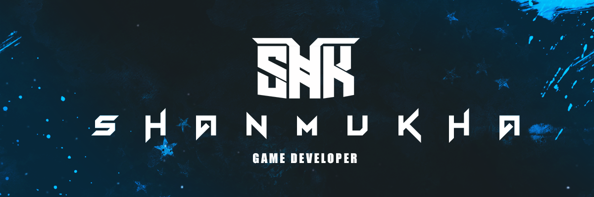

  

  
  
  
  
  
   
  
  

 

<!-- ═══════════════════════════ PLAYER PROFILE ═══════════════════════════ -->

  

  <i>"Creating interactive experiences through code, creativity and experimentation."</i>

 

<!-- ═══════════════════════════ GAMES ═══════════════════════════ -->
<h2 align="center">🔥 PLAY MY GAMES</h2>

Click a card to play · most run free in your browser

  <a href="https://playgama.ai/play/ght3dmoxtxnwl5"></a>
  <a href="https://playgama.ai/play/3pnwa6n5gg6yga"></a>

  <a href="https://shanmukha.itch.io/arcane-ascent"></a>
  <a href="https://shanmukha.itch.io/orbit-rogue"></a>

  <a href="https://shanmukha.itch.io/word-hunter"></a>
  <a href="https://shanmukha.itch.io/tic-tac-toe-online-battle-of-the-board"></a>

  <a href="https://shanmukha.itch.io/last-service"></a>
  <a href="https://shanmukha.itch.io/zombie-rush"></a>

  🎮 More on itch.io: <a href="https://shanmukha.itch.io">shanmukha.itch.io</a> · 📖 Case studies: <a href="https://shanmukha-srinivasa-portfolio.vercel.app/">portfolio</a>

 

<!-- ═══════════════════════════ TOOLS ═══════════════════════════ -->
<h2 align="center">🛠️ TOOLS &amp; APPLICATIONS</h2>

  <a href="https://smarttoolkit.app/"></a>
  <a href="https://debugtheday.vercel.app/"></a>
  <a href="https://shanmukha.itch.io/smart-autosave"></a>

 

<!-- ═══════════════════════════ INVENTORY ═══════════════════════════ -->
<h2 align="center">🧰 INVENTORY</h2>

<table align="center">
  <tr>
    <td align="center"><b>🎮 Engines</b></td>
    <td align="center"><b>💻 Languages</b></td>
    <td align="center"><b>🎨 3D Art</b></td>
  </tr>
  <tr>
    <td align="center"></td>
    <td align="center"></td>
    <td align="center"> </td>
  </tr>
  <tr>
    <td align="center" colspan="2"><b>⚙️ Dev Tools &amp; Web</b></td>
    <td align="center"><b>🧪 Also Used</b></td>
  </tr>
  <tr>
    <td align="center" colspan="2"></td>
    <td align="center">
       
       
       
      
    </td>
  </tr>
</table>

 

<!-- ═══════════════════════════ SKILL TREE ═══════════════════════════ -->

  

 

<!-- ═══════════════════════════ PROTOTYPES ═══════════════════════════ -->
<h2 align="center">🧪 PROJECTS &amp; PROTOTYPES</h2>

  <a href="https://shanmukha-srinivasa-portfolio.vercel.app/"></a>
  <a href="https://github.com/ShanmukhaSrinivasa/RetroPongRebooted"></a>

 

<!-- ═══════════════════════════ STATS ═══════════════════════════ -->
<h2 align="center">📊 PLAYER STATS</h2>

  
  

  

 

<!-- ═══════════════════════════ SNAKE ═══════════════════════════ -->
<h2 align="center">🐍 CONTRIBUTION SNAKE</h2>

  <picture>
    <source media="(prefers-color-scheme: dark)" srcset="https://raw.githubusercontent.com/ShanmukhaSrinivasa/ShanmukhaSrinivasa/output/github-snake-dark.svg" />
    <source media="(prefers-color-scheme: light)" srcset="https://raw.githubusercontent.com/ShanmukhaSrinivasa/ShanmukhaSrinivasa/output/github-snake.svg" />
    
  </picture>

 

<!-- ═══════════════════════════ FOOTER ═══════════════════════════ -->

  <i>"Always learning. Always building. Always improving."</i>

  

  

