<!-- Dark fantasy RPG theme. Cards are generated by scripts/build_cards.py -->

  

  

  
  
  
  
  

 

<!-- ═══════════ CHARACTER SHEET ═══════════ -->

  

  <i>"Creating interactive experiences through code, creativity and experimentation."</i>

 

<!-- ═══════════ QUESTS (games) ═══════════ -->

  

  <a href="https://playgama.ai/play/ght3dmoxtxnwl5"></a>
  <a href="https://playgama.ai/play/3pnwa6n5gg6yga"></a>

  <a href="https://shanmukha.itch.io/arcane-ascent"></a>
  <a href="https://shanmukha.itch.io/orbit-rogue"></a>

  <a href="https://shanmukha.itch.io/word-hunter"></a>
  <a href="https://shanmukha.itch.io/tic-tac-toe-online-battle-of-the-board"></a>

  <a href="https://shanmukha.itch.io/last-service"></a>
  <a href="https://shanmukha.itch.io/zombie-rush"></a>

  More on <a href="https://shanmukha.itch.io">itch.io</a> · Case studies on my <a href="https://shanmukha-srinivasa-portfolio.vercel.app/">portfolio</a>

 

<!-- ═══════════ ARTIFACTS (tools) ═══════════ -->

  

  <a href="https://smarttoolkit.app/"></a>
  <a href="https://debugtheday.vercel.app/"></a>
  <a href="https://shanmukha.itch.io/smart-autosave"></a>

 

<!-- ═══════════ ARSENAL (tech stack) ═══════════ -->

  

<table align="center">
  <tr>
    <td align="center">ENGINES </td>
    <td align="center">LANGUAGES </td>
    <td align="center">3D ART  </td>
  </tr>
  <tr>
    <td align="center" colspan="2">TOOLS &amp; WEB </td>
    <td align="center">ALSO 
      
       
      
      
    </td>
  </tr>
</table>

 

<!-- ═══════════ ABILITIES ═══════════ -->

  

 

<!-- ═══════════ SIDE QUESTS ═══════════ -->

  

  <a href="https://shanmukha-srinivasa-portfolio.vercel.app/"></a>
  <a href="https://github.com/ShanmukhaSrinivasa/RetroPongRebooted"></a>

 

<!-- ═══════════ CHRONICLE (stats) ═══════════ -->

  

  
  

  

  <picture>
    <source media="(prefers-color-scheme: dark)" srcset="https://raw.githubusercontent.com/ShanmukhaSrinivasa/ShanmukhaSrinivasa/output/github-snake-dark.svg" />
    <source media="(prefers-color-scheme: light)" srcset="https://raw.githubusercontent.com/ShanmukhaSrinivasa/ShanmukhaSrinivasa/output/github-snake.svg" />
    
  </picture>

 

<!-- ═══════════ FOOTER ═══════════ -->

  

  

