<!-- Layout: the page is styled like a game engine editor. Panels are generated by scripts/build_cards.py -->

  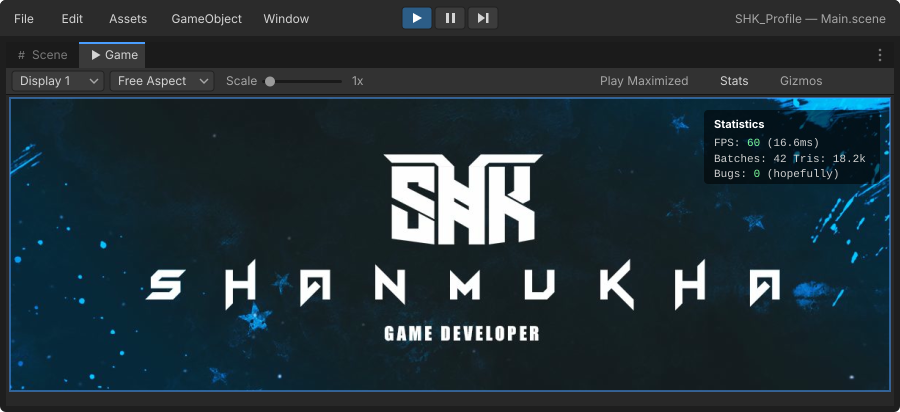

  

  
  
  
  
  

 

<!-- ─── INSPECTOR (about me) ─── -->

  

 

<!-- ─── HIERARCHY + GAME VIEWS (games) ─── -->

  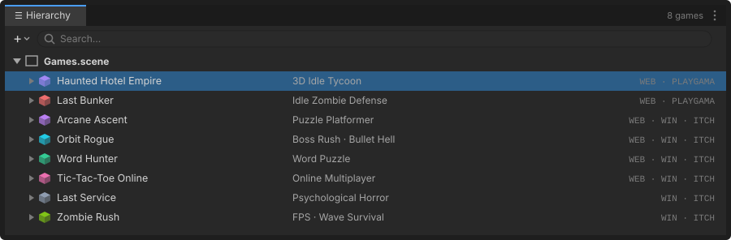

  <a href="https://playgama.ai/play/ght3dmoxtxnwl5">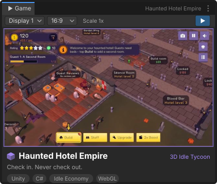</a>
  <a href="https://playgama.ai/play/3pnwa6n5gg6yga">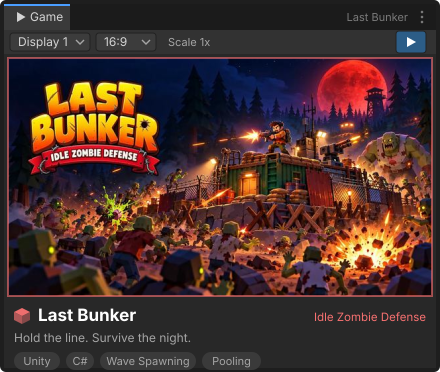</a>

  <a href="https://shanmukha.itch.io/arcane-ascent">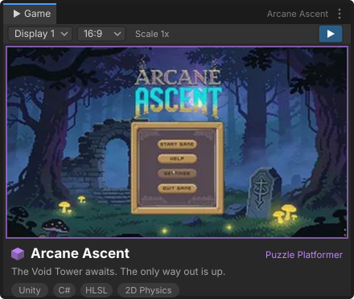</a>
  <a href="https://shanmukha.itch.io/orbit-rogue">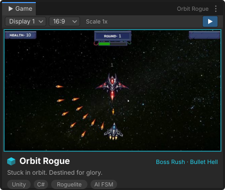</a>

  <a href="https://shanmukha.itch.io/word-hunter">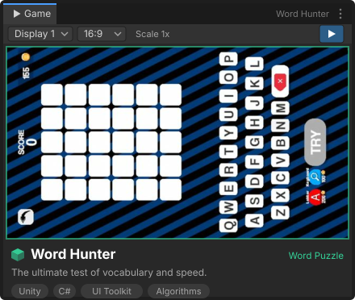</a>
  <a href="https://shanmukha.itch.io/tic-tac-toe-online-battle-of-the-board">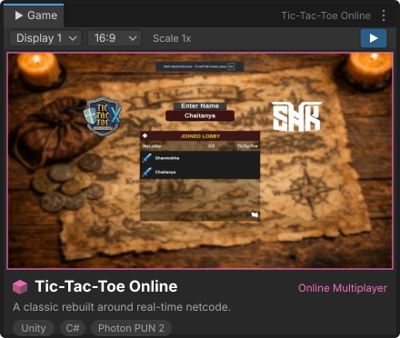</a>

  <a href="https://shanmukha.itch.io/last-service">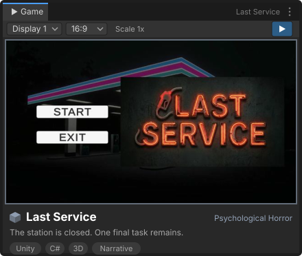</a>
  <a href="https://shanmukha.itch.io/zombie-rush">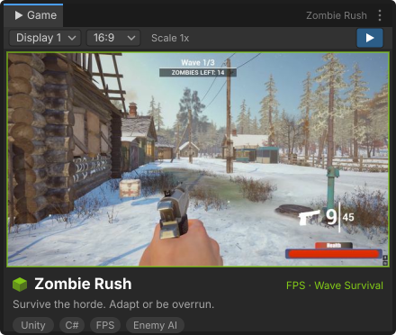</a>

 

<!-- ─── PACKAGE MANAGER (tools) ─── -->

  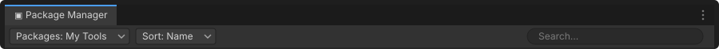
  <a href="https://smarttoolkit.app/">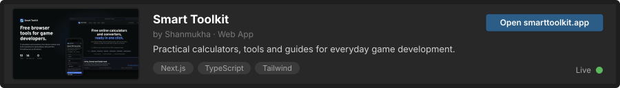</a>
  <a href="https://debugtheday.vercel.app/">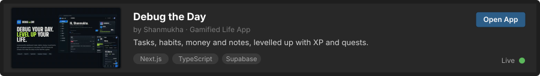</a>
  <a href="https://shanmukha.itch.io/smart-autosave">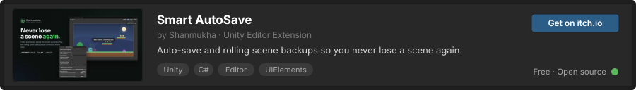</a>

 

<!-- ─── CONSOLE (skills) ─── -->

  

 

<!-- ─── PROJECT (tech stack) ─── -->

  

<table align="center">
  <tr>
    <td align="center">ENGINES </td>
    <td align="center">LANGUAGES </td>
    <td align="center">3D ART  </td>
  </tr>
  <tr>
    <td align="center" colspan="2">TOOLS &amp; WEB </td>
    <td align="center">ALSO 
      
       
      
      
    </td>
  </tr>
</table>

 

<!-- ─── PREFABS (prototypes) ─── -->

  <a href="https://shanmukha-srinivasa-portfolio.vercel.app/">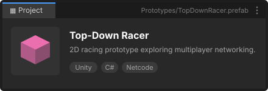</a>
  <a href="https://github.com/ShanmukhaSrinivasa/RetroPongRebooted">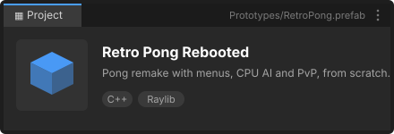</a>

 

<!-- ─── PROFILER (stats) ─── -->

  

  
  

  

<!-- ─── TIMELINE (snake) ─── -->

  

  <picture>
    <source media="(prefers-color-scheme: dark)" srcset="https://raw.githubusercontent.com/ShanmukhaSrinivasa/ShanmukhaSrinivasa/output/github-snake-dark.svg" />
    <source media="(prefers-color-scheme: light)" srcset="https://raw.githubusercontent.com/ShanmukhaSrinivasa/ShanmukhaSrinivasa/output/github-snake.svg" />
    
  </picture>

 

<!-- ─── STATUS BAR (footer) ─── -->

  

  

